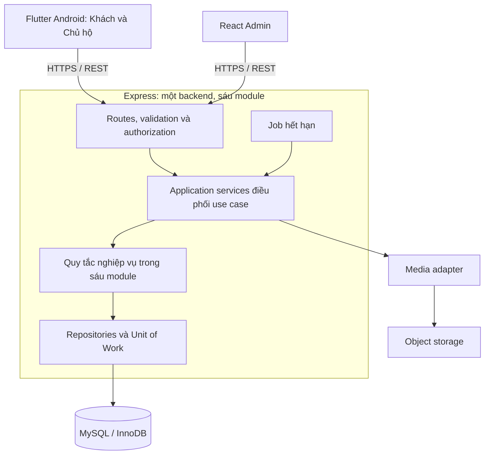

# Kiến trúc hệ thống — bản chốt MVP

Ngày chốt: 10/10/2026. Trạng thái: quyết định thiết kế để triển khai; không khẳng định hệ thống đã có đầy đủ chức năng.

Tài liệu đi cùng [MVP](MVP.md), [Use case](USE_CASES.md), [Đặc tả nghiệp vụ](../docs/business-requirements.md) và [Kịch bản nghiệm thu](../docs/acceptance-scenarios.md). Không thay thế quy tắc nghiệp vụ bằng quyết định kỹ thuật.

## 1. Các quyết định kiến trúc

| Mã | Quyết định chốt | Lý do và hệ quả |
| --- | --- | --- |
| ADR-01 | Backend là một modular monolith Node.js/Express, JavaScript ESM, chia sáu module. | Một đơn vị triển khai, một transaction xuyên các module khi cần; phù hợp quy mô đồ án và code hiện có. |
| ADR-02 | Một ứng dụng Flutter Android có khu vực Khách và khu vực Chủ hộ. | Dùng chung tài khoản và phiên đăng nhập; chủ hộ chuyển khu vực để đặt hộ khác, không cần ứng dụng hoặc tài khoản khách thứ hai. |
| ADR-03 | React/Vite là web dành riêng cho Admin. | Duyệt, kiểm soát nội dung, tài khoản, phản ánh và xem thống kê; không có thao tác xử lý booking/tiền thay hộ. |
| ADR-04 | Một database MySQL/InnoDB dùng chung, phân quyền dữ liệu theo hộ trong application. | Các giao dịch phòng, slot, tài nguyên, proposal và booking có thể commit/rollback cùng nhau. Không tách database theo từng hộ. |
| ADR-05 | Tầng truy cập dữ liệu dùng mysql2/promise, SQL có tham số và repository theo module; migration SQL có phiên bản. | Đã bổ sung driver, pool, kiểm tra TLS và readiness. Repository nghiệp vụ và Unit of Work triển khai theo module; schema không tự tạo khi khởi động. |
| ADR-06 | REST/JSON qua HTTPS; backend là nơi có thẩm quyền tính giá, quyền, trạng thái và khả dụng. | Flutter/React chỉ kiểm tra đầu vào để hỗ trợ người dùng; kết quả cuối do backend xác nhận. |
| ADR-07 | Giữ chỗ và tài nguyên được bảo vệ bằng transaction/khóa MySQL. | Không dùng cache, biến trong tiến trình Node hoặc cron làm nguồn quyết định còn chỗ. |
| ADR-08 | Thông báo trong ứng dụng, xử lý hết hạn bằng job trong cùng codebase; không thêm broker hoặc microservice. | Job hỗ trợ đồng bộ trạng thái và thông báo; khả dụng vẫn đúng nếu job chậm hoặc dừng. |
| ADR-09 | Ảnh lưu ở object storage qua giao diện tương thích S3; MySQL giữ metadata và object key. | Nội dung ảnh không nằm trong cột database; bản nháp và bản công khai được kiểm soát quyền riêng. Tên bucket/host là cấu hình môi trường. |

Việc dùng connection pool, Promise API và truy vấn có tham số dựa trên các khả năng trong [tài liệu MySQL2](https://sidorares.github.io/node-mysql2/docs). Driver đã được cài và kiểm chứng TLS với Aiven; xem [cấu hình Render và kết quả kiểm tra](../backend/RENDER.md). Không dùng Prisma. Kiểm thử kết nối không thay thế kiểm thử transaction nghiệp vụ.

## 2. Các thành phần và kết nối



Các client không truy cập trực tiếp MySQL và không tự nhận giữ chỗ thành công khi chưa có phản hồi server. Ảnh được tải/đọc qua cơ chế được backend cho phép; không mở công khai toàn bộ bucket chứa ảnh nháp.

MVP triển khai một API instance và một job runner dùng chung bản phát hành. Job runner có thể chạy trong tiến trình API, bật bằng cấu hình trên đúng một instance. Khi tăng số instance sau MVP, mọi ghi dữ liệu vẫn phải tuân thủ khóa MySQL và tính chống trùng; không lấy khóa trong bộ nhớ thay thế khóa database.

Web Admin phục vụ bằng static hosting/reverse proxy, API và object storage dùng endpoint cấu hình. Với bản triển khai web, ưu tiên reverse proxy để Admin và API cùng origin. Flutter Android là bản phát hành mobile trong MVP; iOS, Flutter Web và website khách riêng chưa nằm trong lần phát hành này.

## 3. Ranh giới sáu module

| Module | Sở hữu nghiệp vụ | Không chịu trách nhiệm |
| --- | --- | --- |
| identity | User, phiên đăng nhập, vai trò, trạng thái tài khoản, quyền CUSTOMER của HOUSEHOLD. | Không tự duyệt hộ hoặc xác nhận booking. |
| households | Hồ sơ chủ quản lý, đăng ký hộ, xét duyệt/thu hồi, điều kiện được nhận cam kết mới. | Không trực tiếp tự ghi các dòng booking hoặc thu/hoàn. |
| catalog | Phòng/dịch vụ, danh mục, offer, giá, addon, sản phẩm, văn hóa, revision và kiểm duyệt. | Không quyết định tài nguyên đang còn hay không; không sửa snapshot giao dịch cũ. |
| availability | Lịch phòng/lịch chặn, ServiceSlot, Resource, ResourceAssignment, hiệu lực giữ chỗ và hạn mức sử dụng. | Không quyết định ai được xác nhận hoặc số tiền phải hoàn. |
| booking | Booking và hạng mục, CustomScheduleRequest, Proposal/version, điều phối ba luồng đặt, xác nhận/từ chối/hủy. | Không tự bỏ qua availability; không gộp tiền với trạng thái phục vụ. |
| aftercare | Kết quả từng hạng mục, thu/hoàn và thu chi khác, review, phản ánh, truy vấn báo cáo. | Không cấp quyền đặt hoặc hủy từng hạng mục bằng cách ghi kết quả phục vụ giả. |

Notification, audit, clock, media, transaction và cơ chế chống gửi trùng là thành phần dùng chung, không tạo thêm miền kinh doanh thứ bảy. Chúng không được chứa các quy tắc giá/sức chứa của dịch vụ.

Mỗi module có routes/controller, application service, domain rules và repository phù hợp; không bắt buộc tạo interface/class hình thức cho chức năng đơn giản. Controller không truy vấn database trực tiếp. Repository không trả HTTP hoặc tự quyết định quyền actor.

### Điều phối giữa module

- Booking application service gọi catalog để lấy phương án bán hợp lệ và availability để tính/giữ/chuyển/trả cam kết trong cùng Unit of Work.
- Thu hồi duyệt do một application service điều phối households, booking và availability; actor Admin chỉ thực hiện hành động quản trị, các trạng thái đơn chờ được hệ thống kết thúc có lý do.
- Ghi kết quả thuộc aftercare; application service yêu cầu booking tính kết quả tổng và availability trả đúng phần không còn sử dụng. Không để module ghi thẳng vào bảng do module khác quản lý mà bỏ qua quy tắc.
- Báo cáo có thể đọc dữ liệu nhiều module bằng read service được phân quyền. Không dùng đường đọc báo cáo để cập nhật trạng thái.
- Room metadata thuộc catalog, lịch/chiếm dụng Room thuộc availability. Proposal thuộc booking; ProposalHold và các phần giữ khả dụng được availability quản lý, gắn đúng chủ cam kết.

## 4. Transaction, khóa và tính nhất quán

### Cách khóa được chọn cho MVP

Các command thay đổi khả dụng hoặc quyền nhận đặt của một hộ phải bắt đầu bằng transaction trên một connection, khóa dòng household cung cấp dịch vụ làm điểm tuần tự hóa. Sau đó lấy các khóa Room, Resource, ServiceSlot và cam kết cần thiết theo một thứ tự loại đối tượng cố định, rồi tăng dần ID trong từng loại.

Nhờ tất cả đường ghi dùng cùng quy tắc, mở lịch, đặt online, đơn ngoài app, gửi/sửa/chấp nhận proposal, hủy, hết hạn và thu hồi duyệt không đi vòng qua nhau. Đổi giá/điều kiện được dùng khi chốt đơn cũng phải đồng bộ qua điểm khóa hộ để bản snapshot nhất quán. Đọc/tìm kiếm công khai không lấy khóa hộ.

Đây là lựa chọn đơn giản hóa có chủ ý: các command của cùng hộ có thể phải chờ nhau, còn các hộ khác vẫn hoạt động độc lập. Transaction phải ngắn, không chờ khách phản hồi và không gọi upload, dịch vụ ngoài hoặc tác vụ dài trong khi đang giữ khóa.

Unit of Work dùng READ COMMITTED, truyền cùng transaction connection đến mọi repository tham gia; không lấy connection mới giữa giao dịch. Sau khi lấy khóa, đọc lại quyền, phê duyệt, phiên bản, thời gian server và các cam kết đang hiệu lực trước khi kiểm tra. Lỗi deadlock/timeout có retry toàn command với số lần hữu hạn và cùng khóa chống trùng; không retry riêng một phần đã ghi.

Locking read `SELECT ... FOR UPDATE` phải nằm trong transaction; khóa được giải phóng khi commit hoặc rollback. Đây là primitive sử dụng trong thiết kế, không phải bằng chứng thuật toán đã được kiểm thử. Tham chiếu [MySQL: Locking Reads](https://dev.mysql.com/doc/refman/8.4/en/innodb-locking-reads.html).

### Hai cấp khả dụng

1. ResourceAssignment kiểm tra và dành tài nguyên khi mở lịch, kể cả chưa có booking. Pool phải kiểm tra mức dùng đồng thời cao nhất, không cộng mọi lịch giao nhau.
2. Booking/ProposalHold chiếm số người và quota tài nguyên bên trong slot. Dùng chung cả chuyến chỉ phân một lần; quota chia cho booking được trừ theo resourceUsages.
3. Kiểm tra quyền độc quyền cùng lúc với capacity và quota; không suy ra thuê riêng từ số chỗ còn lại.
4. Khi chuyển ProposalHold sang Booking, đổi chủ cam kết nguyên tử, không trả rồi giữ lại. Khi sửa phương án, thất bại phải giữ nguyên phiên bản cũ.
5. Hết hạn có hiệu lực dựa vào thời gian trong mọi truy vấn/command, không đợi job cập nhật. Slot đóng vẫn giữ tài nguyên phục vụ cam kết còn hiệu lực.

### Chống gửi lại và sự kiện

Các thao tác tạo booking, gửi/sửa/chấp nhận phương án, chuyển trạng thái và ghi tiền có khóa chống trùng theo người thao tác + hành động + payload. Kết quả chỉ được công bố sau commit. Cùng thao tác thành công được gửi lại trả cùng kết quả; payload khác với cùng khóa bị từ chối.

Theo [thiết kế CSDL rút gọn v2](Thiet%20ke%20CSDL/README.md), audit và thông báo trong ứng dụng được ghi trực tiếp cùng transaction nghiệp vụ. UNIQUE(event_key, user_id) chống ghi trùng thông báo. Nếu ghi lỗi trước commit, retry toàn command với cùng idempotency key; lỗi đọc thông báo sau commit không đảo booking hoặc ghi thêm tiền. Không có gọi mạng trong transaction. MVP chưa cần outbox hoặc worker tạo thông báo riêng; job vẫn xử lý hết hạn. Khi bổ sung push/email, thêm outbox bằng migration để retry gửi bên ngoài độc lập.

## 5. Client, API và dữ liệu

### Flutter

Một codebase và một APK; có khu vực công khai/khách, khu vực hộ và phần dùng chung. Chuyển khu vực là đổi trải nghiệm giao diện, không tạo tài khoản hoặc phiên mới. Hộ chưa được duyệt vẫn xem tiến độ xét duyệt; hộ mất duyệt vẫn thấy công cụ xử lý đơn cũ theo quyền.

Tách View/ViewModel và Repository/API service, có model dữ liệu dùng chung. Cách phân lớp này tham khảo [hướng dẫn kiến trúc Flutter](https://docs.flutter.dev/app-architecture/guide). Quy tắc hiển thị và kiểm tra đầu vào nằm ở client; tính giá chính thức, giữ chỗ và trạng thái hợp lệ luôn ở backend. MVP cần kết nối mạng để thao tác giao dịch, chưa có chế độ tạo đơn offline trên thiết bị rồi đồng bộ sau.

### React Admin

Chia giao diện theo nhóm tài khoản, hộ, kiểm duyệt nội dung, danh mục, phản ánh và thống kê. Booking được xem theo quyền quản trị; không có endpoint hay nút thao tác xác nhận/hủy hoặc ghi thu/hoàn thay hộ. Các tác động tự động khi thu hồi duyệt phải được hiển thị để Admin hiểu trước khi thực hiện.

### Hợp đồng API

- API nghiệp vụ đặt dưới `/api/v1`; giữ `/api/health` hiện có cho liveness. Readiness kiểm tra database sẽ là endpoint vận hành riêng khi triển khai kết nối.
- Các nhóm: auth/me, public catalog, household management, availability, bookings, custom requests/proposals, aftercare và admin. Dùng chung business service cho cả online và ngoài ứng dụng.
- Các hành động confirm/reject/cancel/accept/finalize có command riêng; không có PATCH tùy ý toàn bộ trường status.
- Duy trì dạng phản hồi `success` cùng `data`, hoặc `error.code` và thông điệp. Mã lỗi phải phân biệt không đủ quyền, trạng thái không hợp lệ, hết hạn, phiên bản cũ và hết khả dụng; không trả chi tiết SQL/secret.
- Request chỉ gửi lựa chọn và số lượng được phép. Server tính quantity suy ra, resourceUsages và tổng tiền. Accept proposal phải gửi đúng ID/version; trường do client gửi không được làm thay đổi snapshot phía server.
- Dữ liệu danh sách có phân trang; tiền VND xử lý theo số nguyên/decimal có kiểm soát, ngày lưu trú giữ nghĩa ngày địa phương, thời điểm lưu/truyền UTC và hiển thị Asia/Ho_Chi_Minh.

### Xác thực và bảo vệ dữ liệu

Dùng access token ngắn hạn và refresh session có thể thu hồi ở server. Trạng thái tài khoản được kiểm tra ở mỗi request bảo vệ; không tin role trong token như căn cứ duy nhất. Token mobile lưu trong secure storage, access token web giữ trong bộ nhớ và refresh token trong cookie HttpOnly/Secure với bảo vệ CSRF/Origin cho các endpoint dùng cookie. CORS chỉ mở origin được cấu hình.

Tài khoản Admin được tạo bằng quy trình quản trị/seed được bảo vệ, không có public signup ADMIN. Mật khẩu được băm bằng thuật toán phù hợp, không lưu dạng rõ. Kiểm tra ownership, giới hạn upload, file type, kích thước request và rate limit các thao tác đăng nhập/đặt là yêu cầu triển khai, không thay thế quy tắc nghiệp vụ.

Object storage giữ ảnh nháp ở chế độ riêng; backend chỉ cấp URL đọc theo quyền và trạng thái xuất bản. Tải ảnh ngoài transaction đặt dịch vụ. Không xóa object đang được revision hoặc snapshot lịch sử tham chiếu.

## 6. Cấu trúc repository và triển khai

```text
backend/
  src/
    app.js, server.js
    modules/identity, households, catalog, availability, booking, aftercare
    application/       # điều phối use case xuyên module
    shared/            # auth policy, transaction, clock, media, audit, errors
    jobs/              # hết hạn và xử lý thông báo
  migrations/          # SQL có phiên bản, tạo ở bước database
  test/
frontend/
  admin-web/           # React/Vite
  mobile-app/          # một ứng dụng Flutter, hai khu vực Khách/Hộ
docs/                  # đặc tả chi tiết và kịch bản nghiệm thu
Tai lieu he thong/     # MVP, kiến trúc, use case
```

Các thư mục modules/application/shared/jobs/migrations là cấu trúc đích, chưa được tạo chỉ để giả thể hiện đã triển khai. Root npm workspace gồm backend và frontend/admin-web; Flutter có toolchain riêng. Các đường dẫn phải thống nhất trong package manifest, lockfile và README.

Giữ một database theo môi trường, không dùng production để chạy test. Migration có phiên bản được thực hiện thành bước triển khai riêng; không tự chạy DDL ở mỗi lần khởi động API. Trước release cần kiểm chứng backup/restore, HTTPS, kết nối DB có TLS xác minh chứng chỉ và cấu hình secret ngoài repository.

Log một dòng JSON với request ID, actor, hành động và lỗi nghiệp vụ, không ghi token/mật khẩu. Theo dõi lỗi API, xung đột/hết hạn giữ chỗ, retry transaction, job chậm và chênh lệch tiền cần xử lý. Cấu hình host, DB, bucket và khóa bí mật thuộc môi trường triển khai, không thay đổi kiến trúc hoặc ranh giới nghiệp vụ.

## 7. Điều kiện chuyển sang thiết kế database

Ba bộ tài liệu MVP, use case và đặc tả nghiệp vụ phải nhất quán. ERD tiếp theo bắt buộc thể hiện: chủ hộ và quyền khách; Room/Service độc lập; hai cấp tài nguyên; Request/Proposal/Hold/Booking riêng; revision nội dung; kết quả từng hạng mục; ledger và lịch sử chuyển trạng thái.

Thiết kế API/OpenAPI và schema chi tiết là bước kế tiếp. Không đánh dấu backend, mobile hoặc 34 ca nghiệp vụ đã hoàn thành từ việc có tài liệu kiến trúc. Khi triển khai, phải dùng MySQL thật để kiểm chứng cạnh tranh tài nguyên, phiên bản phương án và thu hồi duyệt, cùng kiểm thử giao diện cho ba luồng đặt.
