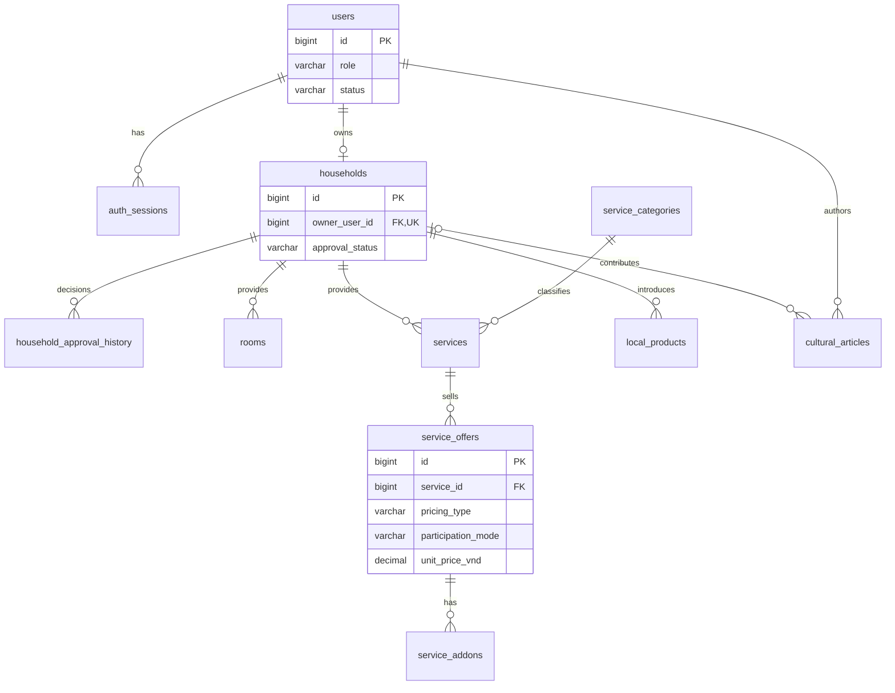
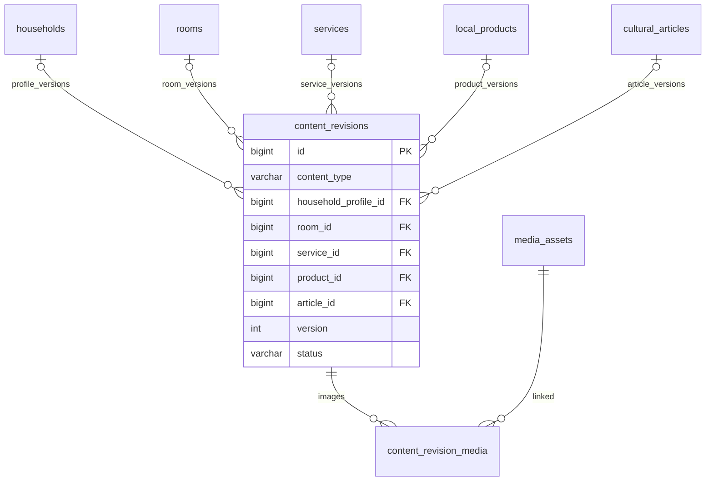
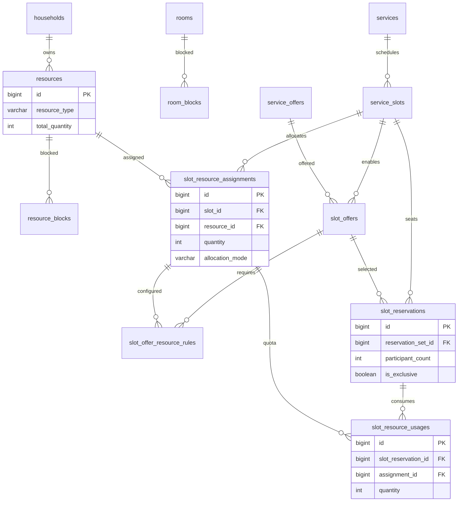
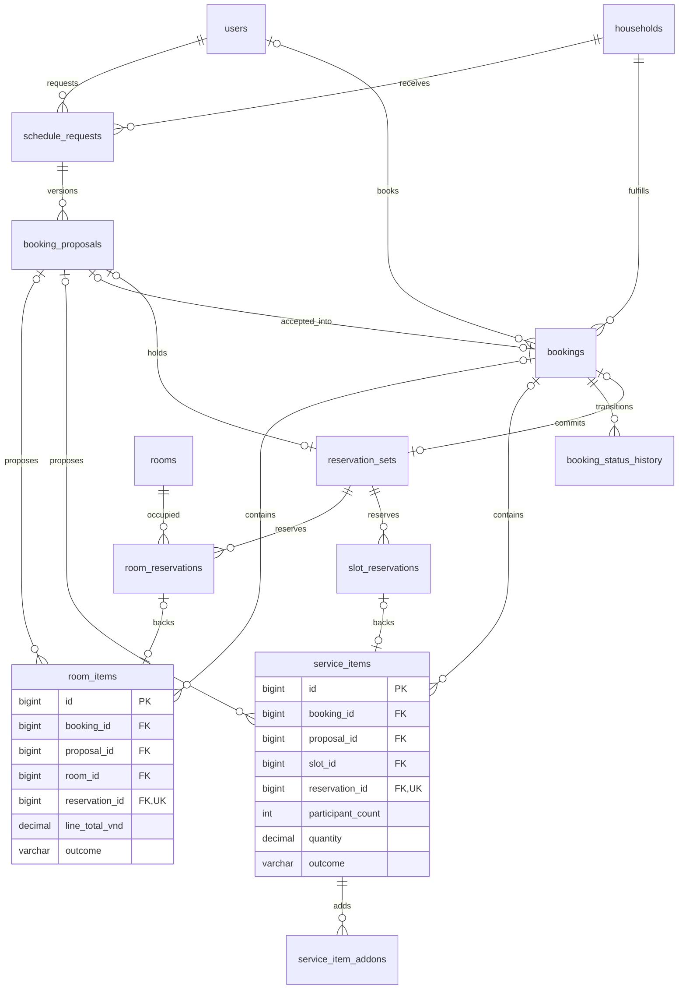
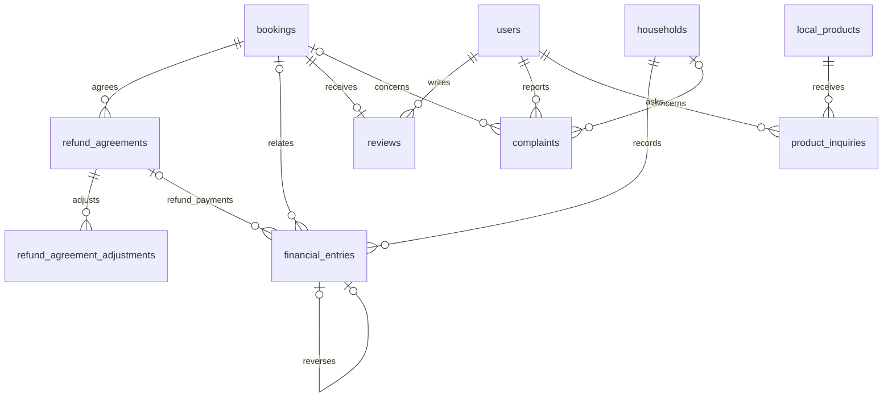
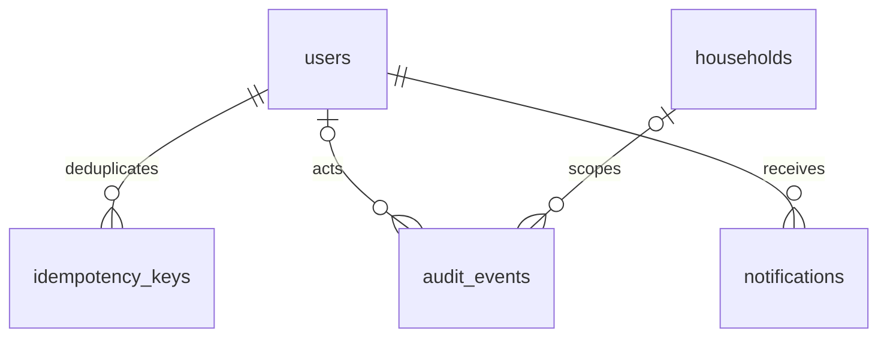

# ERD logic — bản rút gọn 41 bảng

Các sơ đồ dưới đây thể hiện quan hệ logic chính; [DDL](../../backend/migrations/001_initial_schema.sql) và [từ điển](DATA_DICTIONARY.md) là nguồn đầy đủ cho cột và FK ghép. Không vẽ thêm quan hệ N–N khái niệm đè lên bảng nối. Các bảng được lặp giữa sơ đồ để dễ đọc, không phải bảng mới.

## 1. Tài khoản và catalog

## 2. Kiểm duyệt và ảnh

Năm FK chủ revision đều nullable riêng lẻ, nhưng CHECK yêu cầu **đúng một** trong năm có giá trị, khớp content_type. Không có revision vô chủ hoặc thuộc đồng thời một phòng và một dịch vụ. Ngoài các quan hệ trên, mỗi bảng gốc có `published_revision_id` tùy chọn, trỏ tới revision **của chính đối tượng đó** qua FK ghép. FK vòng được thêm sau khi tạo toàn bộ bảng; không cần tắt FOREIGN_KEY_CHECKS.

## 3. Hai cấp tài nguyên và offer của lịch

Khoảng chặn tài nguyên và assignment là cấp hộ; usages là cấp trong lịch. Hai tổng này không cộng vào nhau.

## 4. Ba luồng đặt và nguồn khả dụng chung

Hai đầu 0..1 của reservation set theo từng chủ không có nghĩa set được phép vô chủ: CHECK yêu cầu có booking hoặc proposal. Ở HELD chỉ có một chủ; accept giữ proposal nguồn và thêm booking. Diagram không biểu diễn được điều kiện trạng thái này.

Hạng mục cũng không được vô chủ. Proposal DRAFT có thể chưa giữ chỗ; item đã gắn booking bắt buộc có reservation. Accept giữ nguyên dòng item/snapshot, gắn booking_id đúng proposal nguồn và chuyển set sang COMMITTED. Outcome nằm trên item, mặc định UNRESOLVED; không còn hai bảng outcome riêng.

## 5. Kết quả, tiền và quyền đánh giá

## 6. Ghi nhận và thông báo

notifications được ghi cùng transaction với command, chống trùng bằng event_key/user_id. Chưa có gửi push/email nên không có bảng outbox riêng.

Để xem hình có thể kéo thả, nhập SQL vào model MySQL Workbench theo [hướng dẫn](AIVEN_AND_VALIDATION.md). Chưa tạo file `.mwb` bằng Workbench trong bước này; Mermaid và DDL là các artifact đã cung cấp.
